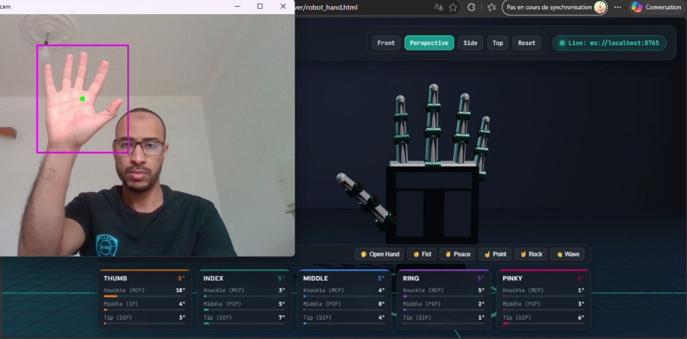
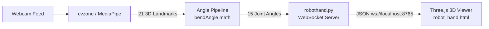

# 🦾 Robot Hand 3D — Real-Time Hand Gesture Teleoperation

[](https://www.python.org/)
[](https://developers.google.com/mediapipe)
[](https://threejs.org/)
[](https://websockets.readthedocs.io/)
[](LICENSE)

A real-time computer vision and 3D teleoperation system that captures hand gestures via your webcam and replicates individual finger movements on an articulated 3D robotic hand in the browser using **MediaPipe**, **OpenCV**, **WebSockets**, and **Three.js**.

---

## 📸 Demonstration



*Real-time webcam tracking (left) mirroring 5 articulated fingers with live angle telemetry in Three.js (right).*

---

## 🌟 Features

- **Real-Time Hand Tracking**: Uses **MediaPipe** & **cvzone** to track 21 hand landmarks at high frame rates.
- **Full 5-Finger Articulation (15 Joints)**:
  - **Thumb**: MCP, IP, and DIP with realistic opposition and curl towards the palm.
  - **Index, Middle, Ring, Pinky**: 3 joint bend angles each (`[knuckle (MCP), middle (PIP), tip (DIP)]`).
- **Low-Latency WebSocket Streaming**: Asynchronous background WebSocket server (`ws://localhost:8765`) broadcasting JSON joint angles to any connected browser client.
- **Procedural 3D Robot Hand (Three.js)**:
  - Futuristic cybernetic model with brushed titanium chassis, tactile silicone pads, servo hinge pins, and glowing optical sensor tips.
  - **Frame-rate independent exponential smoothing** (`lerp`) eliminates camera noise and delivers silky-smooth 60+ FPS animation.
  - **Interactive Orbit Controls**: Drag to rotate, right-click to pan, and scroll to zoom.
  - **Quick Camera Presets**: Front, Perspective, Side, and Top views.
- **Live Telemetry HUD**: Displays real-time numeric degrees (`°`) and color-coded progress bars for each joint.
- **Offline / Standalone Test Poses**: Quick action buttons (**Open Hand**, **Fist**, **Peace**, **Point**, **Rock**, **Wave**) to test the 3D hand without a webcam running.

---

## 🏗️ Architecture & How It Works



### JSON Data Protocol

Every frame update sends a lightweight JSON payload of finger bend angles in degrees (`0° = straight`, positive angles = curled):

```json
{
  "thumb":  [40.0, 50.0, 60.0],
  "index":  [8.0, 5.0, 4.0],
  "middle": [6.0, 5.0, 3.0],
  "ring":   [80.0, 100.0, 65.0],
  "pinky":  [80.0, 100.0, 65.0]
}
```

---

## 📁 Project Structure

```text
├── assets/
│   └── demo.jpg                # Demonstration screenshot
├── viewer/
│   ├── libs/
│   │   ├── three.min.js        # Offline Three.js library
│   │   └── OrbitControls.js    # Offline camera controls
│   ├── robot_hand.html         # Full 3D 5-finger Three.js viewer
│   ├── index.html              # Standard entrypoint (mirrors robot_hand.html)
│   └── demo.html               # Lightweight 2D canvas single-finger demo
├── main.py                     # Main script: webcam capture + tracking + viewer launch
├── robothand.py                # Background WebSocket broadcaster server
├── hand_landmarker.task        # MediaPipe landmark model
├── requirements.txt            # Python dependencies
└── README.md                   # Project documentation
```

---

## 🚀 Getting Started

Follow these steps to set up and run the project locally.

### 1. Prerequisites

- **Python 3.9+** (recommended: Python 3.10 - 3.12)
- A working **Webcam**
- A modern web browser (Google Chrome, Microsoft Edge, Firefox, Brave, Safari)
- **Git** (optional, for cloning)

---

### 2. Clone the Repository

```bash
git clone https://github.com/<your-username>/robot-hand-gesture-control.git
cd robot-hand-gesture-control
```

---

### 3. Create a Virtual Environment

It is recommended to use a virtual environment to manage dependencies:

#### **Windows (PowerShell)**:
```powershell
python -m venv venv
.\venv\Scripts\Activate.ps1
```

> *Tip: If you encounter an execution policy error on PowerShell, run:*
> ```powershell
> Set-ExecutionPolicy -ExecutionPolicy RemoteSigned -Scope CurrentUser
> ```

#### **Windows (Command Prompt / CMD)**:
```cmd
python -m venv venv
.\venv\Scripts\activate.bat
```

#### **macOS / Linux**:
```bash
python3 -m venv venv
source venv/bin/activate
```

---

### 4. Install Dependencies

Install the required libraries using `pip`:

```bash
pip install -r requirements.txt
```

#### Dependencies Included:
- `opencv-python`: Camera capture and image preprocessing.
- `cvzone`: High-level wrapper for hand tracking.
- `mediapipe`: Google's hand and finger landmark detector.
- `numpy`: Vector arithmetic and joint angle calculation.
- `websockets`: High-performance asynchronous WebSocket communication.

---

### 5. Run the Project

Launch the main application:

```bash
python main.py
```

### What happens automatically:
1. The **WebSocket server** initializes on `ws://localhost:8765`.
2. The browser automatically opens `viewer/robot_hand.html`.
3. The **Webcam preview window** opens.
4. When you raise your hand, your fingers are tracked and the 3D robot hand mirrors your movements in real time!

---

## 🎮 Controls & Shortcuts

| Action | Control |
| :--- | :--- |
| **Quit application** | Press <kbd>q</kbd> in the webcam window |
| **Rotate 3D Hand** | Left-click + drag on 3D canvas |
| **Pan 3D Hand** | Right-click + drag (or Shift + Left-click) |
| **Zoom in/out** | Mouse scroll wheel / pinch gesture |
| **Switch View** | Click **Front**, **Perspective**, **Side**, or **Top** buttons |
| **Manual Poses** | Click **🖐️ Open**, **✊ Fist**, **✌️ Peace**, **☝️ Point**, **🤘 Rock**, or **👋 Wave** |

---

## 🔧 Troubleshooting

- **Viewer says "Waiting for Python..."**:
  Ensure `python main.py` is actively running. Keep the browser tab open; it will automatically reconnect once the Python server starts.
- **Port 8765 already in use**:
  Another instance of Python or `main.py` might still be running in the background. Stop previous instances with `Ctrl + C` or terminate Python processes.
- **Webcam not opening**:
  Check if another application (Zoom, Teams, Camera app) is using your webcam. If you have multiple cameras, adjust `cv2.VideoCapture(0)` in `main.py` to index `1` or `2`.
- **MediaPipe installation issues**:
  Ensure you are using a 64-bit Python release and have updated `pip` (`python -m pip install --upgrade pip`).

---

## 📜 License

This project is open-source and available under the [MIT License](LICENSE).
